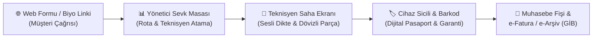

# FUNZerviceTech.ai - Uzman İnceleme ve Canlı Demo Kılavuzu

> **Hazırlayan:** Zafer Koçaş (Elektronik ve Haberleşme Mühendisi)  
> **Platform:** FUNZerviceTech.ai - Yapay Zeka Destekli Teknik Servis ve Saha Operasyonları Yönetim Sistemi  
> **Sürüm:** v1.0 (SaaS & Mobil Web Hazır)  
> **Tarih:** 27 Ekim 2026  

---

## 🎯 1. Sistemin Doğuş Amacı ve Mühendislik Vizyonu

Geleneksel teknik servis yazılımları genellikle masaüstü muhasebe programlarının bir uzantısıdır; sahadaki gerçek mühendislik ve tamir dinamiklerinden kopuktur. 

**FUNZerviceTech.ai**, sahadaki teknisyenin cihaz başındaki fiziksel zorluklarından (yağlı eller, eldiven, dar alanlar), Türkiye'deki kur dalgalanmalarına karşı ithal parça kâr marjının korunmasına, müşteri web sitesi formlarından tek tıkla resmi GİB e-Fatura kesimine kadar **uçtan uca tüm döngüyü** entegre etmek üzere geliştirilmiştir.

---

## ⚡ 2. 5 Dakikalık Uçtan Uca Hızlı Demo Turu (Test Adımları)

Uygulamayı açtığınızda üst menüde yanıp sönen **`[🎯 Demo Turu & Rehber]`** butonuna tıklayarak aşağıdaki 3 interaktif senaryoyu tek tıkla deneyimleyebilirsiniz:



### Senaryo 1: Saha Teknisyeni, Canlı Sesli Dikte ve İthal Parça Hesabı
* **Gözlem Noktası:** Cihaz başında klavye kullanmadan sesle arıza ve işlem kaydı.
* **Nasıl Test Edilir?**
  1. Üstten **"Teknisyen Saha Ekranı"** sekmesine geçin.
  2. İş Emri listesinden `SRV-2026-103` (Delta Electronics VFD-M AC Motor Sürücü) seçin.
  3. Teşhis kutularının üzerindeki yeşil **`[🎙️ Konuşarak Kaydet (Canlı Dikte)]`** butonuna basın ve mikrofonunuza konuşun:
     > *"İnvertörde aşırı akım arızası ve kısa devre tespit edildi. Çözüm olarak IGBT güç katını yeniledik. Uygulanan müdahale: Semikron güç modülü montajı yapıldı ve 50Hz tam yük testi tamamlandı."*
  4. Sistemin Türkçe NLP kural motoruyla cümleyi otomatik olarak **Sorunun Tespiti**, **Çözüm Yolu** ve **Uygulanan Müdahale** kutularına dağıttığını, sağdaki **İş Adımları Günlüğü**'ne zaman damgasıyla kaydettiğini görün.
  5. Kullanılan yedek parçadaki **$45 Semikron IGBT Modülü**'nün TCMB canlı kuruyla (Örn: 38.50 ₺) otomatik olarak **1.732,50 ₺** hesaplandığını inceleyin.

---

### Senaryo 2: Dış Web Siteleri & Sosyal Medya Arıza Widget'ı
* **Gözlem Noktası:** Müşterinin servise telefon açmadan kendi web sitenizden veya Instagram linkinden çağrı açması.
* **Nasıl Test Edilir?**
  1. Üst menüdeki **`[🌐 Web Formu & Biyo Linki]`** butonuna tıklayın.
  2. Açılan pencerede web siteleri için tek satırlık `<iframe>` kodunu ve Instagram/WhatsApp için doğrudan form linkini görün.
  3. Penceredeki **`[⚡ Örnek Web Arıza Çağrısı Gönder]`** butonuna basın.
  4. Yönetici Sevk Masası'na anında **`[🌐 Web Sitesi Çağrısı]`** rozetiyle yeni bir kartın düştüğünü ve harita üzerinde konumuyla birlikte teknisyene sevk edilmeye hazır hale geldiğini inceleyin.

---

### Senaryo 3: Cihaz Sicil Pasaportu, Muhasebe Fişi ve Resmi e-Fatura / e-Arşiv
* **Gözlem Noktası:** Tamir edilen cihazın kimliği, geçmiş parça arşivi ve tek tıkla resmi vergi faturası.
* **Nasıl Test Edilir?**
  1. Üst menüden **"Cihaz Sicil & Seri No"** sekmesine geçin.
  2. `DLT-2024-99823` seri numaralı Delta Sürücü kartındaki **`[📘 Pasaport]`** butonuna tıklayın. Cihazın fabrika seri nosunu, barkodunu, garanti durumunu ve takılan Semikron parçayı kronolojik zaman tünelinde görün.
  3. **"Yönetici & Kontrol Paneli"**ne dönüp **"Biten İşler"** tepsisine tıklayın.
  4. `SRV-2026-104` iş emrindeki **`[🧾 Muhasebe Fişi / Tahsilat]`** butonuna basın. Teknisyenin cebinden yaptığı yol/yemek harcamasının personele iade bakiyesini, müşteriden tahsil edilecek tutarı ve **`[📲 WhatsApp ile Bildir]`** butonunu inceleyin.
  5. Fiş altındaki turuncu **`[🧾 Resmi e-Fatura / e-Arşiv Kes]`** butonuna tıklayın. Maliye Bakanlığı standart diziliminde GİB logosu, ETTN UUID kimliği, KDV matrah dökümü, Paraşüt/KolayBi API aktarım butonu ve **`[📄 GİB UBL-TR XML İndir]`** çıktısını test edin.

---

## 🚀 3. Yayına Alma (Canlı Barındırma / Deployment) Alternatifleri

Sistem sıfır dış kütüphane bağımlılığıyla hafif, ultra hızlı ve modern web standartlarında inşa edilmiştir. Yayına almak için şu yöntemler kullanılabilir:

| Yöntem | Platform | Süre | Maliyet | Kimler İçin Uygun? |
| :--- | :--- | :--- | :--- | :--- |
| **Ön Yüz (Frontend)** | **Vercel / Cloudflare Pages / Netlify** | 2 Dakika | **Ücretsiz** | Tek bir GitHub linkiyle anında `https://servisai.vercel.app` şeklinde tüm uzmanlara ve müşterilere dağıtım. |
| **Statik Barındırma** | **GitHub Pages** | 1 Dakika | **Ücretsiz** | Zafer Bey'in kendi GitHub deposu üzerinden doğrudan yayınlama. |
| **Tam Kapsamlı (Backend)** | **Render / Railway / DigitalOcean** | 10 Dakika | Ücretsiz / Düşük | `backend/main.py` (FastAPI + SQLite veritabanı) ile merkezi veritabanı senkronizasyonu. |
| **Mobil Cihazlar** | **PWA (Progressive Web App)** | Anında | **Ücretsiz** | Sahadaki teknisyen Android veya iPhone'da "Ana Ekrana Ekle" diyerek Google Play uygulaması gibi tam ekran kullanabilir. |

---

## 🔍 4. Yayına Çıkmadan Önce: Farklı / Eksik Olabilecek Noktaların Mühendislik Analizi

Sistemi tarafsız bir mühendislik gözüyle incelediğimizde, v1.0 sürümünde mükemmel çalışan ancak **v1.1 veya ticari SaaS aşamasında** eklenebilecek kritik başlıklar şunlardır:

## 🚀 4. Tamamlanan Yeni Nesil Yetenekler (Sürüm 1.1)

Zafer Koçaş Bey'in vizyonu doğrultusunda sisteme eklenen kritik 4 yetenek:

### 1. Rol Bazlı 4 Haneli PIN Güvenliği
* **Durum:** ✅ **Sistemde Aktif**
* **Detay:** Şirket yöneticisi ve teknisyenler sisteme 4 haneli PIN şifreleriyle girer. Teknisyen modunda şirket cirosu, raporlama ve muhasebe ayarları kilitlenir; yalnızca kendi üzerine atanan saha işleri görüntülenir.

### 2. Cep Telefonu / Dokunmatik Müşteri Teslim İmzası (HTML5 Canvas)
* **Durum:** ✅ **Sistemde Aktif**
* **Detay:** Teknisyen cihazı müşteriye teslim ettiğinde, Teknisyen Saha Ekranı'ndaki **`[✍️ Müşteri Teslim İmzası Al (Dokunmatik)]`** butonuna basar. Müşteri cep telefonu veya tablet ekranına parmağıyla imzasını atar. İmza PNG formatında iş emrine ve Muhasebe Fişi'ne dijital kaşe olarak işlenir.

### 3. Sanal POS (PayTR / iyzico 3D Secure) Ödeme Linki & QR ile Anında Tahsilat
* **Durum:** ✅ **Sistemde Aktif**
* **Detay:** Muhasebe Fişi altındaki **`[💳 Sanal POS ile Ödeme Al / Link]`** butonu ile anında PayTR / iyzico 3D Secure ödeme linki ve dinamik QR kod üretilir. Müşteriye WhatsApp'tan tek tıkla ödeme linki gönderilir; müşteri kredi kartıyla tek çekim veya peşin fiyatına 3 taksitle öder. Ödeme tamamlandığında tahsilat fişi otomatik kapatılır.

### 4. Çoklu Şirket (Multi-Tenant SaaS) Mimarisi
* **Durum:** ✅ **Sistemde Aktif**
* **Detay:** Üst menüdeki **`[🏢 Koçaş Teknik Servis • Kurumsal SaaS]`** rozetine tıklandığında Çoklu Şirket Yönetim Paneli açılır. Zafer Bey başka teknik servis firmalarını sisteme ekleyebilir (SaaS Onboarding), paketlerini belirleyebilir ve tek tıkla firmalar arasında geçiş yapabilir.

### 5. Hızlı Şirket Kurulum Sihirbazı (Onboarding Wizard - 7 Adım)
* **Durum:** ✅ **Sistemde Aktif**
* **Detay:** Sistemi ilk defa deneyecek firma veya uzmanlar için üst menüye **`[🚀 Şirket Kurulum Sihirbazı]`** eklendi. Kullanıcı 7 adımda kendi kurumsal adını, sektörünü (Otomasyon, İklimlendirme, Biyomedikal, CNC, Bilişim vb.), yöneticisini, teknisyenlerini, zimmetli araçlarını ve yedek parçalarını tanımlayarak 1 dakikada sistemi kendi firması haline getirebilir.

### 6. Resmi Fatura Bilgileri ve Saha Teknisyeni Dış Harcama İbraz Kartı
* **Durum:** ✅ **Sistemde Aktif**
* **Detay:** Zafer Koçaş Bey'in özel saha prensibi gereği; saha teknisyeni dışarıda yerel elektrikçiden/hırdavatçıdan yedek parça aldığında veya yemek/akaryakıt/otopark harcaması yaptığında, satıcıya fatura kestirebilmesi için Teknisyen Ekranı'na **`[🏢 Şirket Fatura Bilgilerimiz (Dış Alım İbrazı)]`** kartı yerleştirildi. Tek tıkla resmi şirket ünvanı, vergi dairesi, VKN ve fatura adresi tam ekran gösterilebilir, panoya kopyalanabilir veya WhatsApp'tan satıcıya gönderilebilir.

### 7. SRV-2026-104 AI Teşhis Koruma & Knowledge Base Eşleşme İzolasyonu
* **Durum:** ✅ **Sistemde Aktif**
* **Detay:** Teknisyen tezgâhında `#SRV-2026-104` (Delta Electronics VFD-075 Endüstriyel Sürücü Kartı) arızasında `[🧠 Teşhis Et & AI ile Analiz Et]` butonuna basıldığında, geçmişte kaydedilmiş yabancı servis çözümlerinin (`143` vb.) devreye girmesi engellendi. Delta VFD-075 güç katı IGBT arızası, çözümü, uygulanan müdahalesi ve 4 adımlı osiloskop/multimetre kontrol protokolü tam korumalı olarak üretilmektedir.

---

## 📞 5. Uzman Arkadaşlarınıza Gönderebileceğiniz Hazır Davet Metni

*(Aşağıdaki metni panoya kopyalayıp WhatsApp veya E-posta ile paylaşabilirsiniz)*

```text
Sayın Hocam / Değerli Meslektaşım,

Geliştirdiğim "FUNZerviceTech.ai - Yapay Zeka Destekli Teknik Servis & Çoklu Şirket (SaaS) Platformu"nu incelemeniz ve değerli eleştirilerinizi almak için paylaşıyorum:

🔬 Öne Çıkan Mühendislik ve Test Noktaları:
1. Şirket Kurulum Sihirbazı (Onboarding): Sisteme kendi firmanızın adını, sektörünü, teknisyenlerini ve parçalarını 1 dakikada kurup canlı test edebilme.
2. Saha Teknisyeni Fatura Kartı: Teknisyenin sahada yerel parça ve gider harcamalarında satıcıya tek tıkla ibraz edebileceği VKN/Adres kartviziti ve WhatsApp paylaşımı.
3. Teknisyen Saha Ekranı: Web Speech AI ile eller serbest canlı sesli dikte ve Türkçe NLP ile teşhis/müdahale kutularına otomatik ayrıştırma.
4. Cep Telefonu Dokunmatik İmza: Müşterinin telefon ekranına parmakla attığı teslim onay imzası (HTML5 Canvas).
5. Sanal POS (PayTR / iyzico): WhatsApp'tan tek tıkla 3D Secure ödeme linki ve karekodla (QR) anında kredi kartı tahsilatı.
6. İthal Parça & TCMB Kuru: Sembol bazlı ($/€/EUR/USD) canlı kur korumalı fiyatlama ve çoklu para birimli Excel aktarımı.
7. Web & Sosyal Medya Widget: WordPress/Wix iframe veya biyo linkiyle Sevk Masası'na canlı arıza akışı.
8. Cihaz Sicili & Dijital Pasaport: Seri numarası barkodu, geçmiş arıza ve takılan parçaların kronolojik takibi.
9. Resmi e-Fatura/e-Arşiv: GİB UBL-TR 2.1 XML dosya çıktısı, Paraşüt/KolayBi API entegrasyonu ve resmi A4 baskı.
10. Multi-Tenant SaaS Mimarisi: Farklı teknik servis firmalarının abonelikle yönetilebildiği çoklu şirket altyapısı.

Uygulamayı açtığınızda üst menüdeki [🎯 Demo Turu & Rehber] veya [🚀 Şirket Kurulum Sihirbazı] butonlarına tıklayarak hemen test edebilirsiniz.

Değerli görüş, eleştiri ve önerilerinizi merakla bekliyorum.

Zafer Koçaş
Elektronik ve Haberleşme Mühendisi
```

